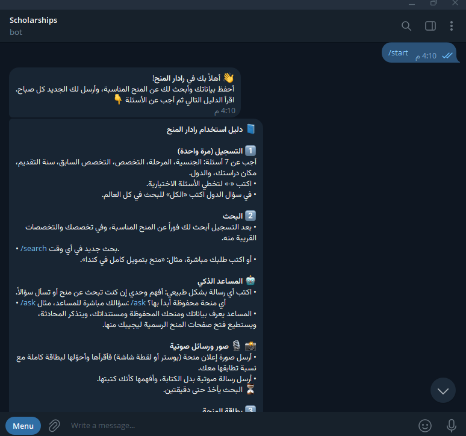
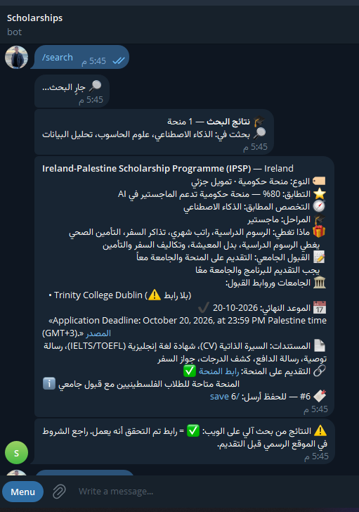
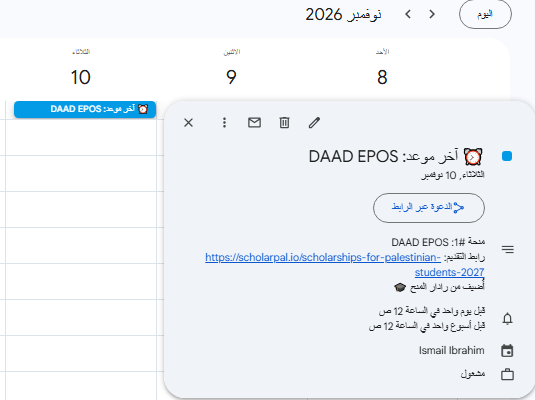
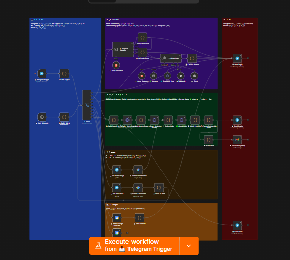

<h1 align="center">🎓 Scholarship Radar</h1>
<p align="center"><b>An AI-powered Telegram assistant that finds, verifies and tracks scholarships for students in Gaza</b></p>

<p align="center">
  
  
  
  
  
  
</p>

---

## 💡 The Problem

Students in Gaza spend hours searching scattered websites for scholarships, often missing deadlines or applying to programs they are not eligible for. Scholarship Radar does the searching, filtering and reminding for them — inside Telegram, in Arabic.

## 📸 Screenshots

<table>
  <tr>
    <td align="center"><b>Onboarding & guide</b><br></td>
    <td align="center"><b>Scholarship card with verified link & deadline</b><br></td>
  </tr>
  <tr>
    <td align="center"><b>Deadline saved to Google Calendar (<code>/save</code>)</b><br></td>
    <td align="center"><b>n8n workflow</b><br></td>
  </tr>
</table>

## ✨ Features

| | Feature | How it works |
|---|---|---|
| 🧾 | **Guided onboarding** | 7 validated questions (nationality, degree, field, previous field, intake year, current university, destinations) |
| 🔎 | **Smart search** | Profile → English query → **Tavily** web search → **Groq LLM** extracts structured scholarship cards (JSON) |
| 🧭 | **Related fields** | Searches the wanted field plus close fields (e.g. Data Science → AI, ML, Statistics) |
| ✅ | **Link verification** | Every link is checked with an HTTP `HEAD` request: ✅ works · ❌ broken |
| ✔️ | **Deadline verification** | A deadline is marked confirmed only if the date appears in the quoted source sentence |
| 🤖 | **AI assistant** | LangChain agent with memory and tools (web page reader, Wikipedia, Think) that knows the user's profile and saved scholarships |
| 🏷️ | **Intent classification** | Free text is classified as *search*, *question* or *off-topic* |
| 📸 | **Poster reading** | Send a scholarship poster → **Gemini Vision** turns it into a full card with a match score |
| 🎙️ | **Voice messages** | Voice notes are transcribed by Gemini and handled like typed text |
| 📅 | **Google Calendar** | `/save` adds the deadline with reminders 1 week and 1 day before |
| ⏰ | **Daily digest & reminders** | Morning report with *new* scholarships only (Telegram + Gmail), reminders 30/14/7/3/1 days before deadlines |
| 📄 | **Documents checklist** | Merged list of required documents across saved scholarships, with `/done` tracking |
| 📊 | **Stats & charts** | `/stats` sends charts via QuickChart |
| 🚨 | **Error handler** | Separate workflow sends throttled error alerts to the admin on Telegram |

## 🏗️ Architecture

```
Telegram ──► Bot Engine (state machine + commands) ──► Route (9 outputs)
                                                         │
   ┌──────────────┬───────────────┬──────────────────────┼───────────────┬───────────────┐
   ▼              ▼               ▼                      ▼               ▼               ▼
 Reply      Intent Classifier   AI Assistant        Search pipeline   Poster/Voice    Calendar
            (Groq)              (Agent + memory      Tavily → Groq →   (Gemini)        add/remove
                                 + tools)            Check Links →
                                                     Format Cards → Telegram + Gmail

Schedule ──► Daily Job (deadline reminders + morning search)
Any failure ──► Error Handler workflow ──► Admin alert on Telegram
```

## 💬 Bot Commands

| Command | Description |
|---|---|
| `/start` · `/edit` | Register / edit profile |
| `/search [request]` | Search now (or just type: *"fully funded master's in Canada"*) |
| `/ask <question>` | Ask the AI assistant |
| `/save N` · `/unsave N` | Save a scholarship (adds it to Google Calendar) |
| `/deadline N YYYY-MM-DD` | Correct a deadline manually |
| `/docs` · `/done N` · `/undo N` | Documents checklist |
| `/stats` | Statistics and charts |
| `/daily on\|off` · `/time H` | Daily digest settings |
| `/profile` · `/reset_seen` · `/delete` | Manage your data |
| `/guide` · `/help` | Full guide / short help |

## 🚀 Setup

**Requirements:** an n8n instance (self-hosted or cloud) reachable over HTTPS for the Telegram webhook.

1. **Import the workflows** — in n8n: *Create workflow → ⋯ → Import from file*:
   - `workflows/error-handler.json`
   - `workflows/scholarship-radar.json`
2. **Create credentials** and select them in each node marked `SET_YOUR_CREDENTIAL`:

   | Credential | Used by | Where to get it |
   |---|---|---|
   | Telegram API | trigger, send/download nodes | [@BotFather](https://t.me/BotFather) |
   | Groq API | classifier, assistant, results organizer | [console.groq.com](https://console.groq.com) |
   | Header Auth (`Authorization: Bearer tvly-…`) | Tavily search | [tavily.com](https://tavily.com) |
   | Google Gemini (PaLM) API | poster reading, voice transcription | [aistudio.google.com](https://aistudio.google.com) |
   | Google Calendar OAuth2 | calendar nodes | Google Cloud Console |
   | Gmail OAuth2 | daily email | Google Cloud Console |

3. **Replace placeholders:**
   - `YOUR_ADMIN_CHAT_ID` in *Error Handler → 02 - Config* (get it from [@userinfobot](https://t.me/userinfobot))
   - `YOUR_EMAIL@example.com` in *✉️ Build Email* and both Google Calendar nodes
4. **Link the error handler:** in *Scholarship Radar → Settings → Error Workflow*, choose *Scholership bot Error Handler*.
5. **Activate** both workflows and send `/start` to your bot.

> The current version is a **personal bot**: the first chat that sends `/start` becomes the owner, and data is kept in n8n workflow static data.

## 🗺️ Roadmap

- [ ] Multi-user version (one profile per Telegram user)
- [ ] Move storage from static data to a real database
- [ ] Curated scholarship sources alongside web search
- [ ] Paginated results with inline "Next" buttons
- [ ] Bilingual interface (Arabic / English)

## ⚠️ Disclaimer

Results come from automated web search and AI extraction. Always verify requirements, links and deadlines on the official scholarship website before applying.

## 👤 Author

**Ismail Ibrahim** — Backend developer from Gaza, Palestine
[LinkedIn](https://www.linkedin.com/in/ismail-ibrahim03) · [GitHub](https://github.com/ismail-sami)
